# EmberLing

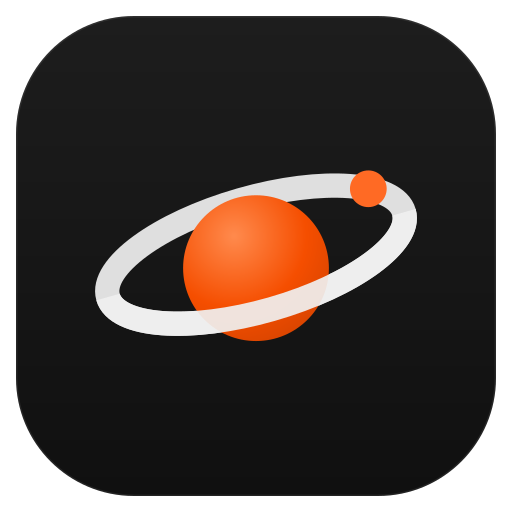

**EmberLing** is a desktop AI agent for Windows — chat, tools, bots, automations, MCP, voice, publishing — rebuilt from static reverse-engineering (REA) of a shipped 124 MB installer (`Grok_Bot_0.75.8_Setup.exe`) and re-wired to run entirely on **free / keyless AI providers**. Built for learning and hackathon use.

> ⚠️ **Caution:** this project reconstructs the UI/UX language and feature surface of a commercial app for educational purposes. It ships none of the original's code, keys, or backend access. Don't use it to impersonate the original product.

> 🔥 **Etymology:** *ember* — one bright dot of fire in orbit — + *-ling*, a small creature. The mascot **Orby** is exactly that: a glowing dot with an orbit ring and a satellite bead. The bot family (Dotlings) shares the same geometry.

**One-line pitch:** every feature of a paid desktop agent, running on a free API key — or no key at all.

---

## Screenshots

| | |
|---|---|
| 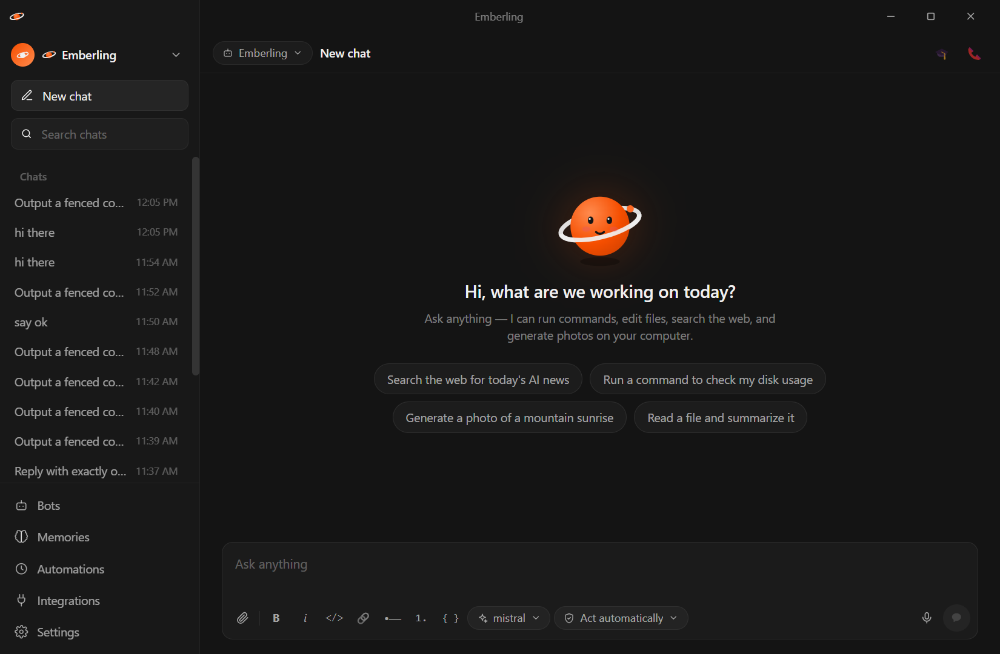 | 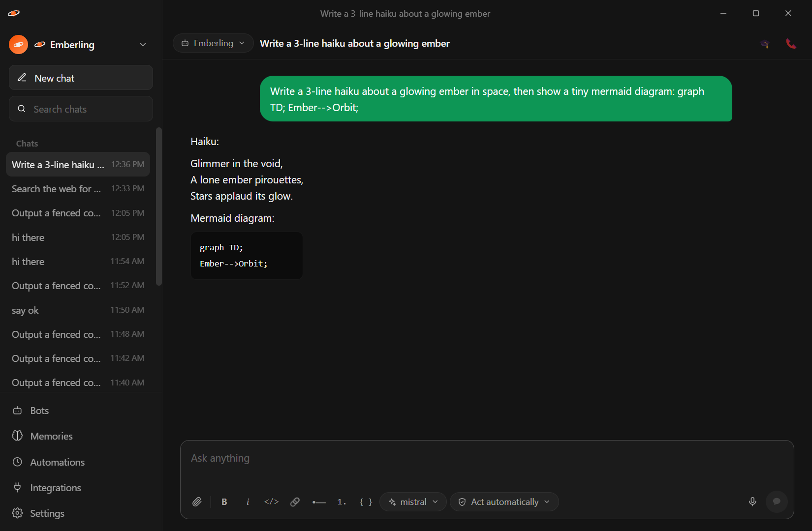 |
| *Greeting + suggestion chips + composer* | *Streaming reply, rich composer, iMessage-style bubbles* |
| 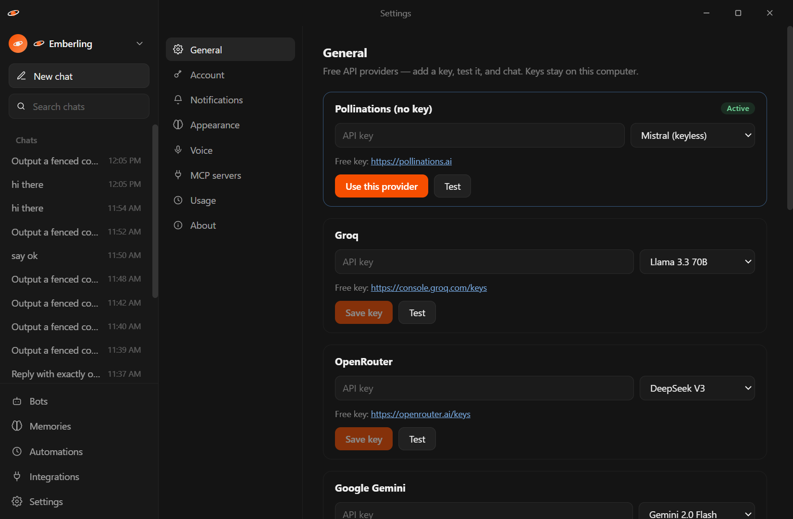 | 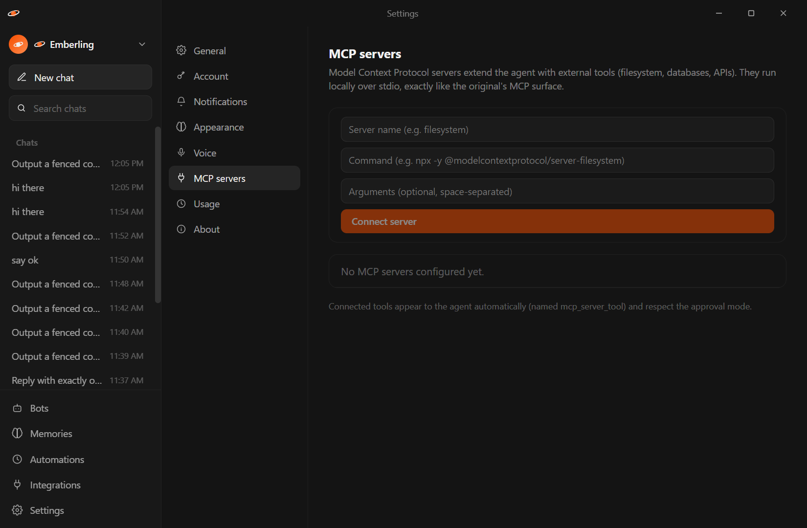 |
| *Free providers with Test button, approval modes, tool toggles* | *Add real stdio MCP servers; their tools join the agent* |
| 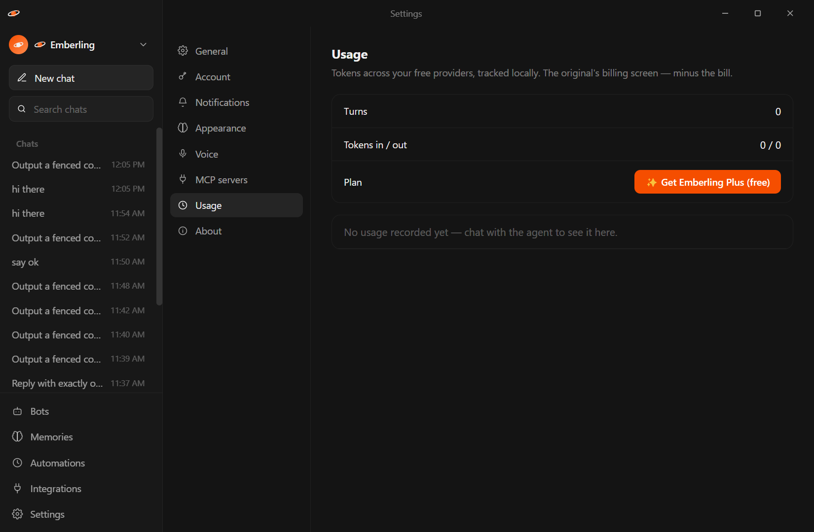 | 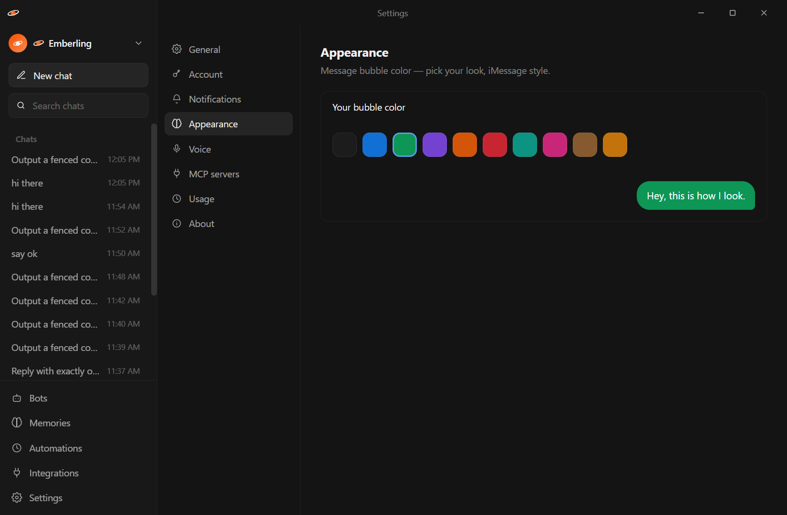 |
| *Local token tracking + Emberling Plus* | *10 bubble colors with live preview* |
| 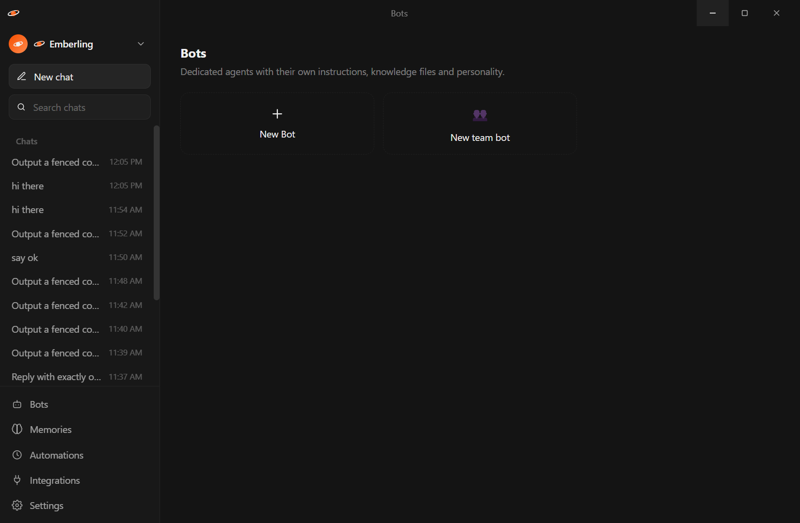 | 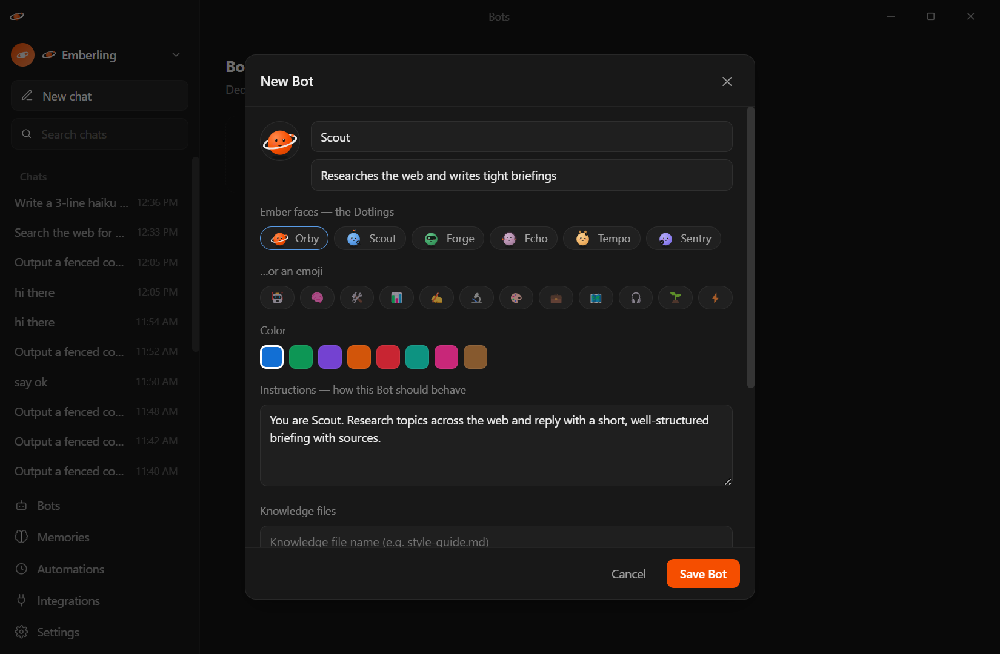 |
| *Personal & team bots, Dotling avatars* | *Bot creation — Dotling faces, instructions, knowledge, templates & publish* |
| 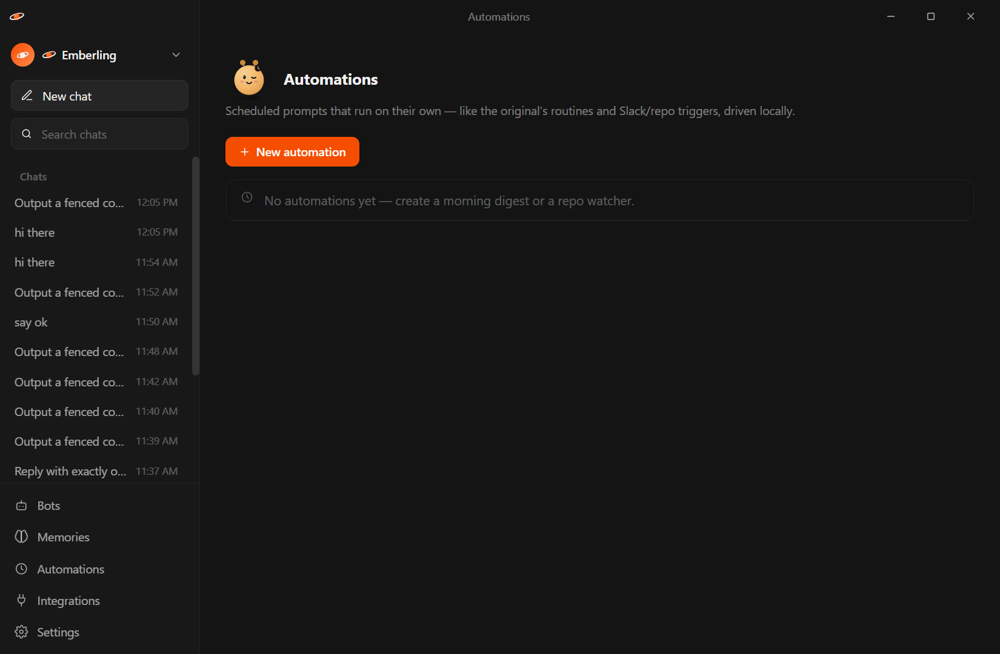 | 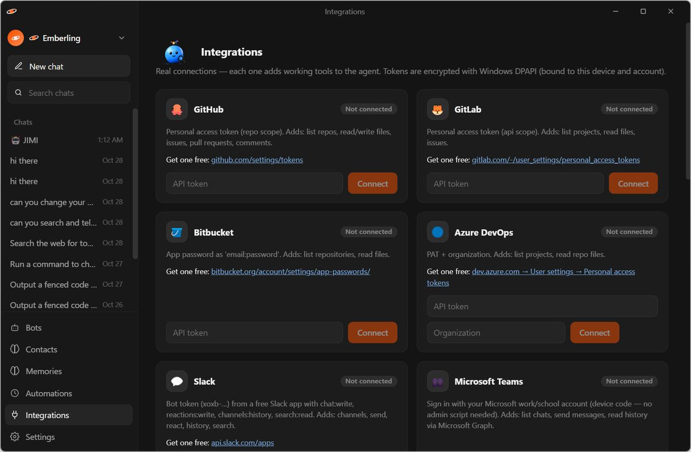 |
| *Scheduled prompts into their own chat* | *The original's connection surface* |

More in [`docs/screenshots/`](docs/screenshots) — including Memories, MCP, and Usage.

The **desktop mark**: an always-on-top draggable orb (click to open, drop files to attach). Lives at the right edge, position remembered across launches. The **tray** carries recent chats, a global "New chat", and orb toggle.

---

## Architecture

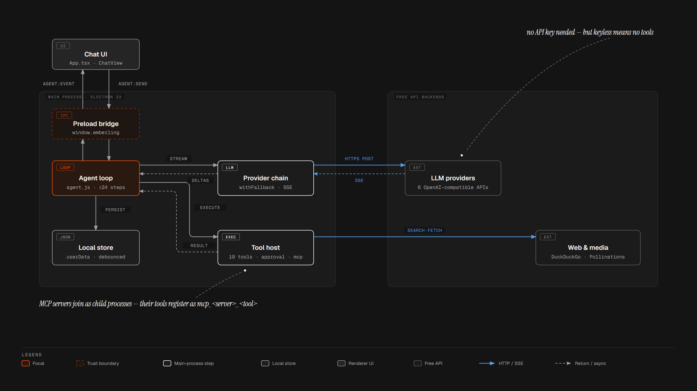

The renderer crosses a contextIsolation IPC boundary into the Electron main process — a pure dispatcher: the agent loop drives a fallback chain of free LLM providers and dispatches an approval-gated tool host to three execution targets (this host, a per-Dotling **WSL Linux VM** that runs approval-free, or a remote **SSH host**), reaches **38 real integration tools** (git hosts, Slack, Teams, email — secrets DPAPI-encrypted, never shown to the model), drives your **installed Chrome/Edge over CDP**, and persists everything to local JSON — including a **versioned per-bot agent store**. Keyless Pollinations chats and calls tools out of the box (text-mode tool protocol); keyed providers unlock native tool calls; MCP servers join as `mcp_<server>_<tool>`. Automations run headless in this process — webhook-triggerable, approval-free inside a VM.

```
┌────────────────────────────── Windows ──────────────────────────────┐
│                                                                     │
│  ┌──────────────┐   IPC (contextBridge)   ┌──────────────────────┐  │
│  │ Main window  │ ◄──────────────────────► │ Electron main        │  │
│  │ React + Vite │   agent:event stream     │ ├─ agent.js (loop)   │  │
│  │ frameless    │   approvals / forms      │ ├─ tools.js (37)     │  │
│  │              │                          │ ├─ integrations (38) │  │
│  │              │                          │ ├─ sandbox.js (WSL)  │  │
│  └──────────────┘                          │ ├─ mcp.js (stdio)    │  │
│  ┌──────────────┐                          │ ├─ providers.js      │  │
│  │ Desktop orb  │ ◄── orb:move/drop ──────►│ ├─ publish.js (http) │  │
│  └──────────────┘                          │ ├─ shell-runner.js   │  │
│  ┌──────────────┐                          │ └─ store.js (JSON)   │  │
│  ┌──────────────┐                          └──────────┬───────────┘  │
│  │ Tray         │◄───────────────────────────────────┘              │
│  └──────────────┘        free providers: Pollinations (keyless),    │
│  ┌──────────────┐         Groq, OpenRouter, Gemini, Cerebras,       │
│  │ Published    │◄── LAN HTTP ── Mistral, or any OpenAI-compatible   │
│  │ web chat     │                                                    │
│  └──────────────┘                                                    │
└─────────────────────────────────────────────────────────────────────┘
```

- **`electron/main.js`** — frameless main window, orb, tray, IPC surface (~40 channels), headless automations scheduler (+ webhook triggers), auto-update via electron-updater (GitHub releases), usage tracking, teach-mode capture.
- **`electron/agent.js`** — tool-calling turn loop: stream → status pill → tool lines → results → continue (max 24 steps); OpenAI tool-call protocol plus a text-mode fallback (```tool blocks) for keyless/small models, with call repair.
- **`electron/tools.js`** — 37 core tools + dynamic MCP/plugin injection; user auto-review rules, then approval gating per mode (ask / askRisky / auto); routes shell & file tools to the sandbox VM or SSH host per execution target.
- **`electron/sandbox.js`** — per-Dotling private WSL Ubuntu VMs (lazily cloned from a base distro); shell/file tools run inside the bot's own VM, approval-free by isolation.
- **`electron/remote.js`** — SSH execution target ("On its computer"): app-generated ed25519 key, Windows OpenSSH client.
- **`electron/browser.js`** — drives the installed Chrome/Edge over CDP (navigate, snapshot, click, type, read, screenshot) with an isolated profile.
- **`electron/agent-store.js`** — per-bot file store (`userData/agent-store/<scope>`) with 20-deep version history.
- **`electron/integration-tools.js` + `electron/integrations/`** — 38 real integration tools: GitHub/GitLab/Bitbucket/Azure repos, Slack, Teams (Graph OAuth), SMTP/IMAP email, iMessage, 1Password (`op` CLI) + workspace tools (unified search, contacts, calendar, skills). Credentials decrypt only inside the dispatcher (DPAPI via `secure-store.js`) — the model never sees tokens.
- **`electron/providers.js`** — OpenAI-compatible streaming client, multi-provider fallback, model-id self-heal, live `/models` discovery into the picker, Whisper transcription.
- **`electron/shell-runner.js`** — the only spawn site. Script text → generated 0600 temp file → executed by absolute path. Never in argv.
- **`electron/mcp.js`** — real MCP stdio JSON-RPC client (initialize → tools/list → tools/call).
- **`electron/publish.js`** — HTTP server hosting published bots as web chats with token links + access control.
- **`src/`** — React renderer: chat (bubbles, tool lines, approval/form cards, mermaid/chart/html/clip blocks), composer, screens (Settings/Bots/Memories/Automations/Integrations/Onboarding), i18n (36 locales), design tokens extracted verbatim from the original's CSS.

### One agent turn

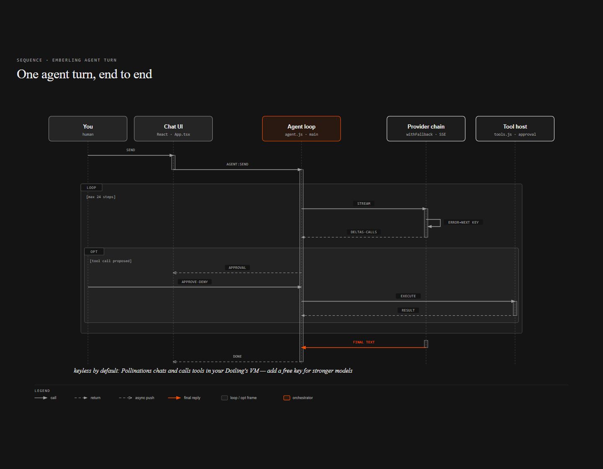

A message flows to the main-process agent loop, which streams from the active provider (failing over to the next configured key on error). Proposed tool calls pass your auto-review rules and the approval mode before the tool host executes them — host-side privileged calls wait on you, sandbox-VM turns run approval-free, and headless runs auto-decline them; results feed back into the next model call, looping up to 24 steps until the final reply streams in.

Design tokens recovered by REA (exact values): chrome `#141414`, pane `#181818`, brand `#f54e00`, accent `#599ce7`, Nord-style semantic palette, 4px spacing scale, 8/12px radii, bubble fills `#1c1c1c` / `#1c1c1c0f`.

---

## Installation

### Option A — One command (PowerShell)

**Install** (latest release, silent):

```powershell
irm https://raw.githubusercontent.com/PiyushAnand2006/EmberLing/main/install.ps1 | iex
```

**Update** (always fetches the latest release and upgrades in place):

```powershell
iwr https://raw.githubusercontent.com/PiyushAnand2006/EmberLing/main/update.ps1 | iex
```

**Options** — pinned versions, portable build, interactive wizard:

```powershell
# a specific version
& ([scriptblock]::Create((irm https://raw.githubusercontent.com/PiyushAnand2006/EmberLing/main/install.ps1))) -Version 0.75.15

# portable build (single exe into your Downloads folder, no install)
& ([scriptblock]::Create((irm https://raw.githubusercontent.com/PiyushAnand2006/EmberLing/main/install.ps1))) -Portable

# see the installer wizard instead of silent install
& ([scriptblock]::Create((irm https://raw.githubusercontent.com/PiyushAnand2006/EmberLing/main/install.ps1))) -NoSilent
```

The installer only ever contacts `github.com` / `objects.githubusercontent.com` (checked in-script), downloads the **versioned** exe from the Releases page, and re-running it over an existing install upgrades in place — chats, bots, memories, keys and Dotling VMs are preserved. Installed apps also self-update (see below).

### Option B — Manual download

Grab a build from [**Releases**](https://github.com/PiyushAnand2006/EmberLing/releases):

| File | What it is |
|---|---|
| `Emberling-Setup-<version>.exe` | NSIS installer (~105 MB) — desktop + start-menu shortcuts, uninstaller |
| `Emberling-Portable-<version>.exe` | Single portable exe (~105 MB) — run from anywhere, installs nothing |

1. Download and run the setup (or the portable).
2. Launch **Emberling**. It works immediately — the default provider (Pollinations) needs **no API key**.
3. Optional: add a free key in **Settings → General** for tool-calling + faster models.

> Windows SmartScreen may warn on unsigned builds — choose "More info → Run anyway", or build from source below.

### Update the app

**Installed (Setup) users — automatic.** Emberling checks GitHub releases at launch and every 6 hours, downloads updates in the background, and shows a **Restart to update** banner when one is ready (dismiss it and the update still applies on next quit). You can also check manually in **Settings → About → Check now**.

<details>
<summary>Manual update (if you prefer)</summary>

1. Quit Emberling — right-click the tray icon (orange dot) → **Quit Emberling** (closing the window keeps it running in the tray).
2. Download the latest `Emberling-Setup-x.y.z.exe` from [Releases](https://github.com/PiyushAnand2006/EmberLing/releases).
3. Run it — the NSIS installer detects the existing install and upgrades **in place** (same folder, same shortcuts). No uninstall needed first.
4. Launch from the desktop/start-menu shortcut. Your data (chats, bots, memories, keys) lives in `%APPDATA%\emberling` and is never touched by an update.
</details>

**Portable users:** just download the new `Emberling-Portable-x.y.z.exe` and run it — replace the old file whenever you like; the two can coexist. (Portable builds can't self-update; they show a "Get it from GitHub" button instead.)

**From-source users:**

```powershell
git pull
npm install          # picks up any new dependencies
npm start            # rebuild + launch
```

**Rollback:** every release keeps its artifacts — grab any older `Emberling-Setup` from the releases list and install over the newer one to downgrade.

### Recent releases

| Version | Highlights |
|---|---|
| **v0.75.15** | Composer pill polish - model/approval/mic on the right side, editor stretching from the + hub; docked at the bottom in all layouts |
|---|---|
| **v0.75.14** | Orchestration (Rooms: every member Bot processes each message; `bot_message` delegation, depth-capped), self-protection firewall (install tree / security configs / self-kill denied), one-command PowerShell install + update, WSL sandbox verified live on real distros, browser stop + restore-bubble fixes, pill composer + Composer actions menu, bot chats fronted by their Dotling face |
| **v0.75.13** | Teams sign-in completes (consent-fallback client chain, token refresh, staged errors); automation completion/failure visibility (failure toasts, error entries, per-automation notify toggle) |
| **v0.75.12** | Per-Dotling private Linux VMs (approval-free execution, headless automations), browser control over CDP, versioned per-bot agent store, auto-review rules, automation webhooks + Run now, live streaming STT, link previews, KaTeX, in-app auto-updater |
| v0.75.10–11 | Integration stack (GitHub/GitLab/Bitbucket/Azure, Slack, Teams, SMTP/IMAP, 1Password, SSH remote), plugins/skills/contacts/calendar, computer-use clicks, TipTap composer, MCP marketplace, 36-locale i18n, Dotling mascots |
| v0.75.9 | Keyless web search, command & task execution (Pollinations tools), DuckDuckGo fallbacks, first auto-updater groundwork |

### Option B — From source (development)

```powershell
git clone https://github.com/PiyushAnand2006/EmberLing.git
cd EmberLing
npm install
npm start        # build renderer + launch electron
npm run dev      # hot-reload dev mode
```

Requires Node 18+ and npm. First run generates the icon set (`npm run icons` is pre-committed in `build/`).

---

## Commands

| Command | What it does |
|---|---|
| `npm start` | Build the renderer and launch the desktop app |
| `npm run dev` | Vite dev server + Electron with hot reload |
| `npm run build` | Build the renderer only (`renderer-build/`) |
| `npm run typecheck` | TypeScript strict check |
| `npm run icons` | Regenerate `build/icon.ico` + PNG sizes from `assets/brand/app-icon.svg` |
| `npm test` | Launch the app and run the three CDP suites (synthetic, real-click, menu) |
| `npm run pack` | Package unpacked (`release/win-unpacked/`) |
| `npm run dist` | Build NSIS installer + portable exe into `release/` |

---

## What's inside (feature walkthrough)

**Chat** — iMessage-style bubbles with 10 user colors, reactions (yours *and* the agent's via `react_to_message`), retry, copy, message editing with revision history, per-conversation drafts, offline queued sends (provider down → messages held with a "Send now" pill), unread badges, pin/mute/delete, full-text search.

**Composer** — markdown toolbar (bold/italic/code/link/lists/code block), slash commands (`/image`, `/video`, `/diagram`, `/chart`, `/preview`, `/search`, `/form`, `/teach`), file attachments, voice memos with playback + transcription, model picker, approval chip, bot selector.

**Agent tools (42 core)** — `run_command`, `read_file`, `write_file`, `edit_file`, `list_dir`, `web_search` (keyless), `web_fetch`, `link_preview` (SSRF-guarded), `generate_photo` (keyless), `generate_video` (keyless clips), `screenshot` (app), `screen_screenshot`, `screen_click`/`screen_scroll` (real input automation), `spawn_subagent`, `request_user_form`, `react_to_message`, `send_email` (mailto + .eml draft), `list_windows`, `focus_window`, `type_text`, `get_window_rect`, `save_memory`, plus the 8 **browser** tools, 6 **agent store** tools and 5 **orchestration/routine** tools below. Each is individually toggleable in Settings → General.

**Linux sandbox — per-Dotling VMs** — Settings → General → *Linux sandbox (WSL)*: install a base distribution once (one UAC prompt), and **every Dotling gets its own private WSL Ubuntu VM** cloned lazily from that image — fully isolated filesystems, no per-bot download. With the target on, shell/file tools execute inside the VM in POSIX bash **without any approval prompt** (the VM boundary is the isolation), automations and webhook runs execute headlessly in their Dotling's VM, and a **Run now** button tests any automation on demand. While a VM is unavailable, tools fall back to this computer with an explicit note — and host-side actions keep their normal approval gating.

**Browser control** — the agent drives your installed Chrome or Edge over the Chrome DevTools Protocol (isolated persistent profile, no bundled Chromium): `browser_open` / `browser_snapshot` (numbered interactive elements) / `browser_click` / `browser_type` (real mouse + key events) / `browser_scroll` / `browser_read` / `browser_screenshot` (saved into the chat as an image) / `browser_close`. Clicks and typing sit behind the approval gate; navigation is http(s)-only.

**Agent store** — each bot gets a **private, versioned document store** on this device (`userData/agent-store/<bot>`): `store_write` keeps a 20-revision history, `store_read` can fetch any revision, plus `store_list` / `store_search` / `store_versions` / `store_delete`. This is the agent's durable local memory — the cloud AgentStoreService of the original, kept on your disk.

**Auto-review rules** — pattern-based overrides evaluated before the approval mode: e.g. auto-allow `git status`, always ask before `npm publish`, deny `/rm -rf/`. Plain-text or `/regex/` patterns match against the tool call; first match wins. Edited in Settings → General.

**Automation webhooks + Run now** — any automation can expose a keyed `POST http://127.0.0.1:<port>/webhook/<id>?key=…` trigger (loopback-only server, token shown once, copied to clipboard on enable). The Automations screen has a **Run now** button for on-demand testing.

**Orchestration — Rooms & delegation** — add multiple Bots as **Room members** and every member processes each message in turn, each with its own instructions, VM scope and store; replies land as separate bubbles labeled with the Bot's name and a status dot (the original's group chats + room-member turns, local edition). And a Bot can hand work to a peer mid-task: `bots_list` / `bot_message` delegate a self-contained subtask to another Bot, which runs as a full agent turn with the target's identity, knowledge and VM — the exchange is recorded in the target Bot's own conversation. Depth-capped at 2 so chains can't recurse; self-delegation refused.

**Self-protection firewall** — the agent cannot modify its own code or security settings: writes and shell commands touching the installed app tree, the `.asar` bundle, or the security-gating config files (`settings.json`, `integrations.json`, `mcp.json`, `automations.json`) are denied **before** approval, and self-kill commands (`taskkill` Emberling) are refused. These denials cannot be overridden by approval mode or auto-review rules — mirroring the original's write-protection / workspace-boundary policy engine (`writeProtectionMapping`, `additionalReadonlyPaths`, `networkPolicyStrict`).

**Voice mode** — 📞 in the header: **live streaming speech-to-text** (Web Speech API — keyless, no recording round-trip) with a Whisper-memo fallback, agent reply, spoken answer. **Teach mode** — 🎓 records your screen as timed frames the agent learns a task from.

**Extras** — `link_preview` fetches Open Graph/Twitter metadata for any URL; chat renders **KaTeX math** (`$…$`/`$$…$$`) alongside mermaid, charts, graphs and 3D blocks; out-bound web requests resolve hosts and refuse loopback/private ranges (SSRF guard); the app **auto-updates** from GitHub releases with a Restart-to-update banner (portable builds get a "Get it from GitHub" button).

**MCP** — connect any stdio MCP server; discovered tools are injected into the agent turn automatically (named `mcp_<server>_<tool>`) and respect the approval mode.

**Rich blocks** — ```` ```mermaid ```` diagrams, ```` ```chart ```` (bar/line/pie SVG), ```` ```html ```` sandboxed previews, ```` ```clip ```` frame players; **docx** renders via mammoth, **xlsx** via SheetJS, **pdf** opens a viewer window.

**Bots** — personal + team bots with Dotling faces, instructions, knowledge files, **template export/import**, and **publishing**: any bot becomes a live web chat on your LAN (`http://<ip>:<port>/agent/<id>?token=…`) with access control — a real hosted agent, no cloud bill.

**Voice mode** — 📞 in the header: mic → transcription → agent → spoken reply (see above for the live-STT path). **Teach mode** — 🎓 records your screen as timed frames the agent learns a task from.

**Automations** — daily or every-N-minutes prompts that run head-first into their own conversation with a notification, plus webhook triggers and Run-now testing (see above).

**Free providers** — Pollinations (keyless default), Groq (also powers Whisper), OpenRouter, Google Gemini, Cerebras, Mistral, or any OpenAI-compatible endpoint. Multiple keys = automatic failover between providers.

---

## Feature parity vs the original

| Feature | Original | EmberLing |
|---|---|---|
| iMessage-style chat, reactions, streaming | ✅ | ✅ |
| Status pills ("Working", "Reading a file"…) | ✅ | ✅ |
| Rich composer, attachments, voice memos | ✅ | ✅ |
| Message edit / drafts / queued sends | ✅ | ✅ |
| Agent: shell + files + web + images | ✅ | ✅ |
| Photo generation | ✅ (paid) | ✅ (keyless) |
| Video generation | ✅ (paid) | ✅ (keyless clips) |
| Screenshots (app + screen) | ✅ | ✅ |
| Subagents | ✅ | ✅ |
| User forms | ✅ | ✅ |
| Computer use (windows, keystrokes) | ✅ | ✅ |
| MCP servers | ✅ | ✅ (real stdio client) |
| Bots + knowledge + avatars | ✅ | ✅ (+ Dotlings) |
| Team bots | ✅ (cloud) | ✅ (local) |
| Bot templates / share | ✅ | ✅ (JSON + clipboard) |
| Publish agents to the web | ✅ (cloud) | ✅ (LAN-hosted) |
| Automations / routines | ✅ (cloud) | ✅ (local scheduler) |
| Memories | ✅ | ✅ (+ agent-written) |
| Voice calls | ✅ | ✅ (local voice mode) |
| Learn from demonstration | ✅ | ✅ (screen recording) |
| Docx/xlsx/pdf viewers | ✅ | ✅ |
| Mermaid/d3/three visualizations | ✅ | ✅ mermaid + charts |
| Desktop mark orb | ✅ | ✅ |
| Tray | ✅ | ✅ |
| i18n | ✅ 34 locales | ✅ 36 locales |
| Usage dashboard | ✅ | ✅ (local) |
| Slack/Teams/iMessage delivery | ✅ (backend) | ✅ (Slack API, Teams Graph, SMTP/IMAP; iMessage on macOS) |
| Cloud box ("On its computer") | ✅ | ✅ (per-Dotling WSL VMs + SSH remote host) |
| Browser control | ✅ (computer use) | ✅ (CDP over your real Chrome/Edge) |
| Agent file store | ✅ (cloud) | ✅ (local, versioned per bot) |
| Room orchestration (Bots process each message) | ✅ (cloud rooms) | ✅ (local rooms + member turns) |
| Bot-to-bot delegation | ✅ | ✅ (`bot_message`, depth-capped) |
| Agent self-protection firewall | ✅ (daemon policy engine) | ✅ (local guard: install tree, security configs, self-kill) |
| Meetings (join/transcribe/summarize) | ✅ | — (planned) |
| Payments / upgrades | ✅ | ✨ free ("Emberling Plus") |

---

## Tests

Three CDP suites drive the real app end-to-end (launch → evaluate → real mouse events → assertions):

| Suite | Covers |
|---|---|
| `scripts/launch-and-test.mjs` | 20 synthetic-click checks across chat, composer, settings |
| `scripts/real-click-test.mjs` | 8 real-mouse click checks (hit-testing, overlays) |
| `scripts/menu-items-test.mjs` | menu selection, conversation menus, reactions |
| `scripts/feature-test.mjs` | publish server round-trip, mermaid rendering, MCP section |
| `scripts/agent-textmode-test.js` | tool-calling agent loop vs a scripted provider (text-mode + API tool protocols, split-call repair, empty-reply retry) |
| `scripts/tools-direct-test.js` | direct tool surface: run_command, file ops, window listing, approval flags |
| `scripts/sandbox-test.js` | WSL sandbox: path translation, per-Dotling VM naming, script guards, live probe/exec when a distro exists |
| `scripts/features-test.js` | agent store (versioning/scopes/traversal), SSRF guard, browser URL guard, auto-review precedence, approval-free VM execution |
| `scripts/media-lenient-test.js` | lenient tool-arg JSON recovery + keyless photo/clip/fetch |
| `scripts/updater-smoke-test.mjs` | packaged-app boot + live auto-update check against GitHub releases |

Run `npm test` for the four CDP suites (launches their own app instance); the Node suites run standalone with `node scripts/<name>`. The MCP client additionally has a scripted round-trip against `scripts/test-mcp-server.cjs` (connect → list → call → assert).

---

## Files

| Path | What it is |
|---|---|
| `electron/main.js` | Windows, tray, IPC, scheduler, usage, teach capture, integrations IPC |
| `electron/preload.js` | contextBridge surface (`window.emberling`) |
| `electron/agent.js` | Tool-calling turn loop (API + text-mode tool protocols) |
| `electron/tools.js` | 42 tool defs + dispatch + approval gating + remote/sandbox routing |
| `electron/guard.js` | Self-protection firewall — install tree, security configs, self-kill denied |
| `electron/sandbox.js` | Per-Dotling WSL Ubuntu VMs — isolated, approval-free execution |
| `electron/browser.js` | CDP control of the installed Chrome/Edge |
| `electron/agent-store.js` | Per-bot file store with version history |
| `electron/screen-state.js` | Per-Dotling virtual screen state (VM activity feed) |
| `electron/shell-runner.js` | Privileged shell execution (only spawn site) |
| `electron/remote.js` | SSH remote execution — "On its computer" |
| `electron/integrations/` | GitHub/GitLab/Bitbucket/Azure, Slack, Teams (Graph), iMessage, email (SMTP/IMAP), 1Password |
| `electron/integration-tools.js` | Section-A + workspace tools dispatched to the agent |
| `electron/plugins.js` | Plugin registry (built-in weather/places/currency + manifest installs) |
| `electron/contacts.js` `electron/calendar.js` `electron/skills.js` | Local address book, events + ICS, replayable procedures |
| `electron/computer-use.js` | Click/scroll/window automation (user32 P/Invoke) |
| `electron/secure-store.js` | DPAPI-encrypted secrets at rest |
| `electron/license.js` | Offline HMAC-signed Plus license keys |
| `electron/web-tools.js` | Keyless search / fetch / photo / video |
| `electron/providers.js` | Provider registry, streaming, fallback, self-heal, Whisper |
| `electron/mcp.js` | MCP stdio JSON-RPC client |
| `electron/publish.js` | LAN hosting for published bots |
| `electron/store.js` | Debounced JSON persistence in userData |
| `src/components/` | ChatView, Composer (TipTap), Sidebar, Markdown (mermaid/chart/graph/three/html/clip), AttachmentViewers, Menu, Icons, Brand |
| `src/screens/` | Settings, Bots, Memories, Automations+Calendar, Contacts, Integrations, Onboarding |
| `src/styles/tokens.css` | REA-extracted design tokens |
| `assets/brand/` | App icon SVG, mark, wordmark, Dotling characters |
| `build/` | Generated icon.ico / icon.png set |
| `docs/REA-FINDINGS.md` | The reverse-engineering evidence log |
| `docs/screenshots/` | All README screenshots |
| `scripts/` | Test suites, icon generator, capture tooling |

---

## Notes & ethics

- Everything stays on your machine: conversations, bots, memories, keys (`%APPDATA%\emberling\*.json`). Integration tokens are DPAPI-encrypted (device-bound). The only outbound traffic is to the AI provider you configure, the services you explicitly connect, and keyless public endpoints (DuckDuckGo, Pollinations, wttr.in, Nominatim, er-api).
- Shell commands are the agent's core capability (as in the original) but are user-approved by default, sandboxed to a non-interactive shell with no profile, delivered via a generated temp script file, and tied to the turn's abort signal. Remote ("On its computer") execution uses key-based SSH you configure.
- Published bots are token-gated and can be restricted to localhost.
- This project exists to document how a shipped agent app is put together. Please use it only where running an AI assistant is permitted, and don't pass it off as the original product.

## By-design exclusions (Block D)

These subsystems of the original are intentionally **not** replicated because they exist to serve the vendor, not the user:

- **Statsig feature flags / A-B experiments** — replaced by local defaults; no remote config, no experiment enrollment.
- **Sentry + OTLP telemetry pipelines** — removed entirely; errors go to the local console only.
- **Account-based gating calls home** (machine labels, roster checks, license servers) — Plus licensing is offline-verified HMAC instead.

Everything else from the original is either implemented (see the parity table above), locally re-imagined (Slack/Teams/Email via your own tokens, SSH instead of their cloud VM), or listed honestly as simulated.

## License

MIT — see [LICENSE](LICENSE).
